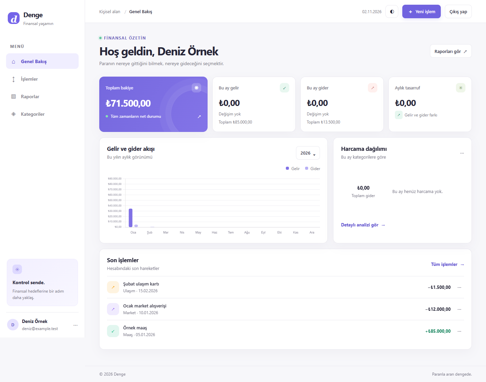
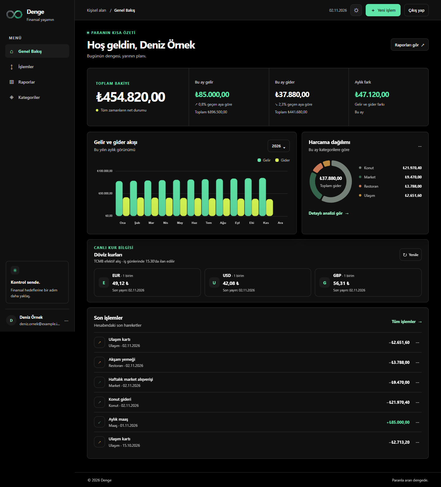
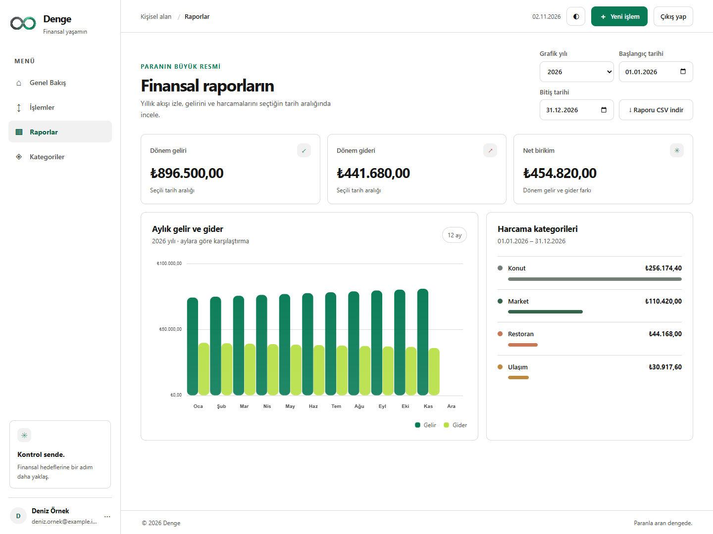
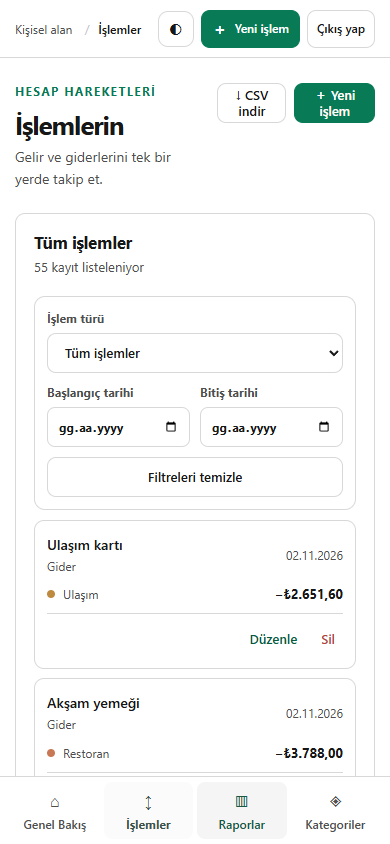

# Denge — Kişisel Finans Takipçisi

Denge, gelir ve giderleri güvenli bir MySQL veritabanında izlemek için geliştirilmiş Türkçe bir kişisel finans uygulamasıdır. Bakiyeyi ve raporları kayıtlardan hesaplar; dövizli işlemlerde TCMB efektif alış kurunu uygular ve kullanıcıya düzeltme imkânı verir.

## Öne çıkanlar

- Google hesabıyla giriş ve kullanıcılar arasında veri yalıtımı
- Gelir, gider ve kategori yönetimi
- Aylık dashboard, grafikler, tarih filtreleri ve CSV raporları
- TRY ve EUR/USD/GBP dahil dövizli işlemler; TCMB efektif alış kuru, elle düzeltme ve kur geçmişi
- Dashboard’da EUR/USD/GBP için son yayımlanan TCMB kur paneli
- TCMB kur paneli; iş günlerinde 15.30 yayınına göre seyrek otomatik yenileme
- Siyah/kömür siyahı koyu tema, beyaz açık tema ve yeşil vurgu; mobil uyumlu arayüz
- MySQL migration’ları, API doğrulaması ve otomatik testler

## Ekran görüntüleri









## Teknoloji ve mimari

- Angular 22, TypeScript ve SCSS
- Node.js ve Express REST API
- MySQL ve `mysql2`; uygulamada SQLite kullanılmaz
- Chart.js, Google Identity Services ve `google-auth-library`
- Angular Karma/Jasmine, Node test runner, Supertest ve Playwright

Angular arayüzü `my-finance/src/` altında; API, migration ve API testleri `my-finance/server/` altındadır. API her finans kaydını oturum açan kullanıcının kimliğiyle sınırlar. Google kimlik jetonu sunucuda doğrulanır, oturum çerezi `HttpOnly` olarak saklanır. Üretim ortamında MySQL TLS zorunludur.

Dövizli işlemin özgün tutarı seçilen para biriminin alt biriminde, raporlara giren karşılığı ise TL kuruşu olarak saklanır. İşlem gününde önceki iş gününde yayımlanmış TCMB efektif alış kuru kullanılır; kur değişiklik geçmişi ayrı tutulur ve işlem açıklamasına otomatik metin eklenmez.

TCMB kurları iş günlerinde 15.30’da ilan edilir. Dashboard paneli açılışta yüklenir, ardından Türkiye saatiyle 15.40’ta iş günlerinde yenilenir; kullanıcı isterse elle de güncelleyebilir. Canlı kur için API sunucusunun `www.tcmb.gov.tr` adresine HTTPS erişimi gerekir. Node 22 başlatma komutları Windows sistem güvenilir sertifikalarını TLS doğrulamasını kapatmadan kullanır. Erişim sağlanamazsa kur alanı boş bırakılır ve kullanıcıya elle giriş durumu açıkça gösterilir.

## Yerel çalıştırma

Gereksinimler: Node.js 22.22.3 veya üzeri (22.x), npm ve MySQL test/yerel veritabanı.

```bash
cd my-finance
npm ci
```

`my-finance/.env.example` dosyasını `.env` olarak kopyalayın; MySQL ve Google OAuth Web Client ID değerlerini yerel `.env` dosyasına girin. Gizli değerleri Git’e eklemeyin. Kurulumun ayrıntıları için [çalıştırma ve yapılandırma kılavuzuna](my-finance/README.md) bakın.

```bash
npm start
```

Arayüz `http://localhost:4200`, API `http://localhost:3000/api` adresinde açılır. İlk başlatmada bekleyen MySQL migration’ları uygulanır. Üretim build’i `npm run build` ile; production sunucusu `npm run start:prod` ile başlatılır.

## REST API

Finans endpoint’leri Google oturumu gerektirir. Tam istek örnekleri ve yanıt açıklamaları [API kılavuzunda](my-finance/README.md#rest-api) bulunur.

| Metot | Endpoint | İşlev |
| --- | --- | --- |
| GET, POST | `/api/transactions` | İşlemleri listele veya ekle |
| PUT, DELETE | `/api/transactions/:id` | İşlemi düzenle veya sil |
| GET | `/api/transactions/:id/rate-history` | Kur geçmişi |
| GET | `/api/categories` | Kategorileri listele |
| POST | `/api/categories` | Kategori ekle |
| PUT, DELETE | `/api/categories/:id` | Kategoriyi düzenle veya sil |
| GET | `/api/exchange-rates?currency=USD&date=YYYY-MM-DD` | TCMB efektif alış kuru |
| GET | `/api/dashboard/summary` | Bakiye ve dönem özeti |
| GET | `/api/reports/monthly`, `/api/reports/yearly` | Dönem raporları |
| GET, PUT | `/api/settings` | Kullanıcı ayarları |

## Test ve CI

```bash
npm run build
npm test -- --watch=false --browsers=ChromeHeadless
npm run test:api
$env:MYSQL_TEST_MODE='1'; npm run test:mysql
npm run test:e2e
```

MySQL entegrasyon ve E2E testlerini yalnızca test veritabanında çalıştırın. Testler benzersiz geçici hesaplar kullanır ve bunları temizler. GitHub Actions, her push ve pull request için geçici MySQL servisi açarak build ve testleri çalıştırır.

## Üretim dağıtımı

Kök dizindeki `Dockerfile`, Angular üretim çıktısını ve Express API'yi tek Node.js servisi olarak paketler. İmajı kök dizinden oluşturun; çalışma ortamında gizli değerleri platformun secret/environment ayarlarından verin. Gerekli değişkenler `GOOGLE_CLIENT_ID`, `MYSQL_HOST`, `MYSQL_PORT`, `MYSQL_DATABASE`, `MYSQL_USER` ve `MYSQL_PASSWORD` değerleridir. `APP_ORIGIN` gerçek HTTPS adresine ayarlanmalı, `MYSQL_SSL=true` etkinleştirilmeli ve gerekiyorsa sağlayıcının CA sertifikası `MYSQL_SSL_CA` ile tanımlanmalıdır.

Uygulama `PORT` üzerinden dinler ve `/api/health` sağlık kontrolü sağlar. Platformda HTTPS sonlandırmasını açın ve veritabanı bağlantı bilgilerini yalnızca gizli ortam değişkeni olarak yönetin; `.env` dosyasını imaja veya Git'e koymayın. TCMB otomatik kuru için çalışan sunucunun `www.tcmb.gov.tr` adresine giden HTTPS erişimine izin verilmelidir. Kalıcılık MySQL sağlayıcısının veritabanı ve yedekleme politikasına bağlıdır; otomatik yedekleme ve geri yükleme adımları dağıtım sağlayıcısı seçildiğinde ayrıca yapılandırılmalıdır.

## Lisans

© 2026 Ceren Kurucu. All rights reserved. This project is proprietary. Unauthorized copying, modification, or commercial use is prohibited.
