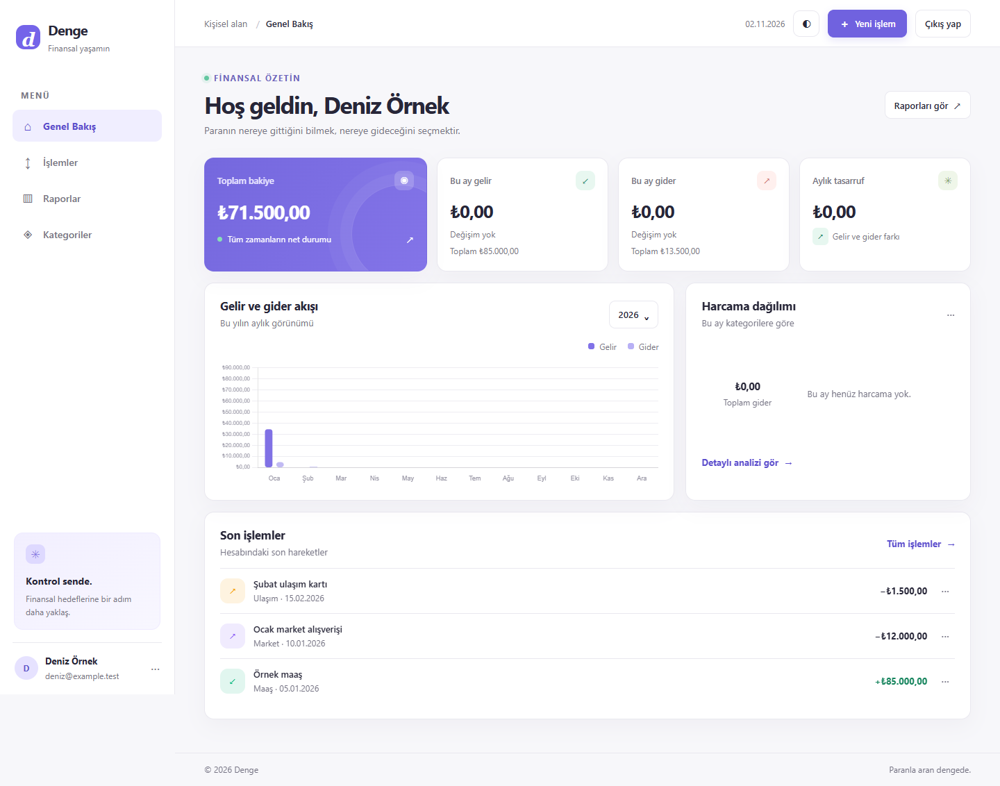
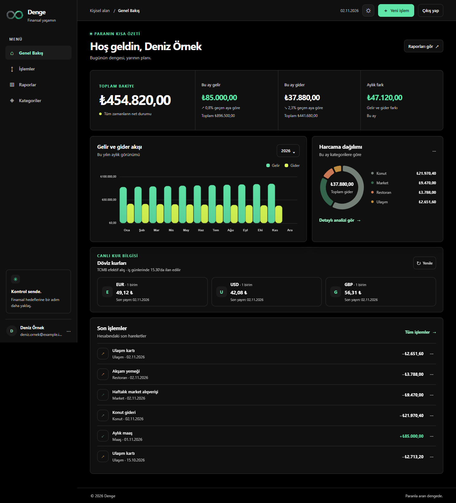
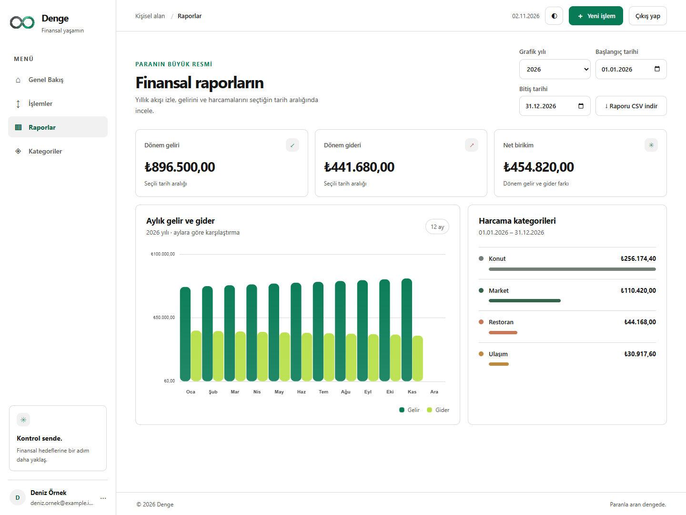
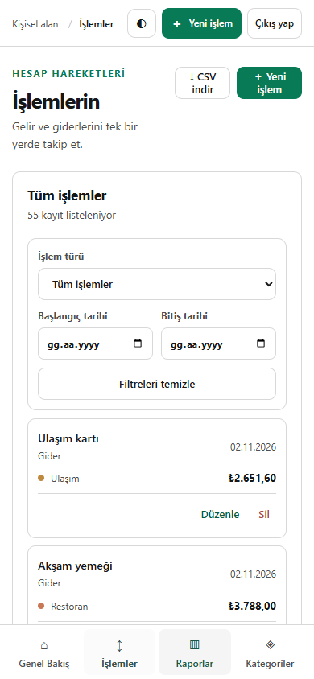

# Denge — Kişisel Finans Takipçisi

Denge, Türkçe arayüzlü bir kişisel finans takip uygulamasıdır. Gelir ve giderleri kuruş hassasiyetinde kaydeder, bakiyeyi işlem kayıtlarından hesaplar ve finansal hareketleri özetler.

## Özellikler

- Gelir ve gider ekleme, düzenleme, silme, tür ve tarih aralığı filtreleme
- Hazır kategoriler ve kullanıcı kategorileri; gelir ve gider için ayrı işlem varsayılanı ve simge seçimi
- Bakiye, aylık gelir/gider, son işlemler ve kategori harcama özeti
- Aylık ve yıllık raporlar, tarih aralığına göre kategori analizi ve CSV dışa aktarma
- Açık/koyu tema; responsive masaüstü ve mobil arayüz
- Tam siyah koyu zemin ve saf beyaz açık zemin; yeşil yalnızca etkileşim ve grafik vurgularında kullanılır
- Segoe UI Variable tabanlı tipografi ve Denge sonsuzluk logosu; üçüncü taraf font isteği gönderilmez
- Kalıcı MySQL depolama ve API doğrulaması
- Google hesabıyla giriş ve hesaplar arasında kullanıcıya özel veri ayrımı
- TCMB efektif alış kuruyla dövizli işlem kaydı, elle kur düzeltme ve kur geçmişi
- Dövizli işlemlerde orijinal tutar ile raporlarda kullanılan TL karşılığının birlikte gösterimi
- CSV, XLS, XLSX ve metin tabanlı PDF ekstreleri için tarayıcıda önizleme, doğrulama ve seçmeli içe aktarma
- Mükerrer kayıt kontrolü, transfer/kart borcu ödemelerini tüketim harcamasından ayırma ve iadeleri net giderden düşme
- Kullanıcı kategorilerine bağlı merkezi işyeri eşleştirmeleri; düzeltilen sınıflandırmayı sonraki işlemler için hatırlama
- Gerçek işlem geçmişinden finansal analiz, 30/60/90 günlük harcama örüntüleri ve açıklanabilir tasarruf planları
- Kategori bazında korunacak tutar ve azaltma kapasitesi belirleme; plan ilerlemesini ve öneri tercihlerini takip etme

## Teknolojiler ve mimari

- Angular 22, TypeScript, SCSS, Angular Forms ve HttpClient
- Express.js REST API, Node.js ve `mysql2` promise pool
- `google-auth-library` ile sunucu tarafında Google ID token doğrulaması
- Sürümlü MySQL şema migration’ları `server/migrations/mysql/` altında sıralı olarak uygulanır. Tutarlarda alt birimler integer saklanır; bakiye ayrı bir tabloda tutulmaz.
- İşlem toplamındaki `amount` alanı TL kuruşunu, dövizli kaydın `original_amount` alanı seçilen para biriminin alt birimini tutar. Kaynak para biriminin ondalık hassasiyeti ISO para birimi kuralından alınır. Kur ve TCMB referansı ayrıca saklanır; kur değişiklikleri `exchange_rate_logs` tablosunda işlemle birlikte kaydedilir.
- TCMB kurları yalnızca sunucu tarafından resmi XML yayını üzerinden alınır. Alış yönü `BanknoteBuying / Unit` hesabıyla efektif alış olarak kullanılır. İşlem tarihi için bir önceki günden başlanır, hafta sonları atlanır ve son yayımlanmış iş günü kuru seçilir; kurun yayın tarihi işlemde saklanır. Bugünün XML dosyası beş dakika, arşiv dosyaları 24 saat önbellekte tutulur ve aynı dosya için eşzamanlı istekler birleştirilir. TCMB kurları gösterge niteliğindedir.
- Dashboard EUR/USD/GBP için son TCMB efektif alış yayınını gösterir. Açılışta bir defa yüklenir; iş günlerinde Türkiye saatiyle 15.40’ta yenilenir. Elle yenileme seçeneği de bulunur.
- Node 22 uygulaması işletim sisteminin güvenilir sertifika deposunu TLS doğrulaması açık olarak kullanır (`--use-system-ca`); TCMB bağlantısı için TLS kontrolü devre dışı bırakılmaz.
- İstemci tarafı rendering kullanılır. Angular SSR kaldırılmıştır; sunucu uygulaması Express API ve production statik dosyalarını sunar.
- Aylık gelir/gider ve kategori dağılımı grafikleri responsive Chart.js bileşenleriyle çizilir.
- Kullanıcılar Google `sub` kimliğiyle tanımlanır. Her işlem, kategori ve ayar `user_id` ile sınırlandırılır; oturum kimlikleri veritabanında yalnızca SHA-256 özetiyle saklanır.
- Ekstre dosyası istemcide ayrıştırılır; sunucuya dosyanın kendisi veya hesap/kart numaraları gönderilmez. Sunucuda yalnızca seçilen ve doğrulanan işlem kayıtları, dosyanın SHA-256 tekrarlama anahtarı ve hassas ad taşımayan içe aktarma geçmişi tutulur. Mükerrer adayları otomatik silinmez; onay kullanıcıya bırakılır.
- Finansal analiz motoru deterministiktir ve kişisel veriyi harici bir yapay zekâ servisine göndermez. Yetersiz veya seyrek işlem geçmişinde alışkanlık önerisi ve dönem referansı üretmez. Kategori azaltma sınırları kullanıcıca düzenlenir; zorunlu giderler işyeri adına bakılarak otomatik azaltılabilir sayılmaz.

## Gereksinimler

- Node.js 22.22.3 veya üzeri (22.x)
- npm

## Kurulum ve çalıştırma

```bash
npm install
npm start
```

`npm start` MySQL API’yi ve Angular geliştirme sunucusunu birlikte başlatır. Uygulama genellikle `http://localhost:4200`, API `http://localhost:3000/api` adresindedir. 4200 portu doluysa kullanılabilir sonraki port seçilir ve terminalde gösterilir. API başlangıcında sürümlü migration’lar gerekli tabloları oluşturur. İstemciyi tek başına çalıştırmak için `npm run start:client`; API’yi tek başına çalıştırmak için `npm run start:api` kullanın. Production için önce `npm run build`, sonra `npm run start:prod` çalıştırın.

### MySQL veritabanı

`.env.example` dosyasını `.env` olarak kopyalayın ve `MYSQL_HOST`, `MYSQL_PORT` (varsayılan `3306`), `MYSQL_DATABASE`, `MYSQL_USER` ve `MYSQL_PASSWORD` değerlerini yerel olarak doldurun. `.env` Git’e eklenmez. Uygulama başlangıcında MySQL advisory lock ile bekleyen sürümlü migration’lar sırayla uygulanır. `MYSQL_SSL=true` TLS doğrulamasını açar; sağlayıcının özel CA dosyası gerekiyorsa `MYSQL_SSL_CA` yolunu belirtin. `NODE_EXTRA_CA_CERTS` Node.js’in ek sertifika deposudur; MySQL bağlantı adresi veya parolası değildir. Production ortamında TLS zorunludur. Sertifikasız test bağlantısında TLS kapalı bırakılabilir; gerçek finansal verileri şifrelenmemiş bağlantıda kullanmayın. Production başlatması için ayrıca `GOOGLE_CLIENT_ID` ve uygulamanın tam `APP_ORIGIN` HTTPS origin’i zorunludur; uygulama bunlar eksikse başlamaz. Giriş cookie’si `HttpOnly`, `Secure` ve `SameSite=Lax` nitelikleriyle gönderilir. Mutasyon isteklerinde production Origin başlığı zorunlu tutulur ve eşleşmeyen origin reddedilir. Reverse proxy arkasında dağıtım yapıyorsanız yalnızca sabit ve kontrolünüzdeki proxy sayısını `TRUST_PROXY_HOPS` ile belirtin; proxy kullanmıyorsanız ayarlamayın.

Bu sürüm SQLite kullanmaz. Önceden oluşmuş yerel SQLite dosyası varsa silinmez veya otomatik aktarılmaz; uygulama tarafından okunmaz. Eski kayıtlar gerekiyorsa ayrıca kontrollü, doğrulamalı aktarım gerekir.

### Google girişi

1. Google Cloud Console’da OAuth consent screen’i ayarlayın ve bir **Web application** OAuth Client ID oluşturun.
2. Yerel geliştirme için `http://localhost:4200` adresini authorized JavaScript origin olarak ekleyin. Geliştirme sunucusu başka porta geçerse o origin’i de Google ayarlarına ekleyin.
3. `my-finance/.env.example` dosyasını `my-finance/.env` olarak kopyalayıp `GOOGLE_CLIENT_ID` değerini girin; API’yi yeniden başlatın.
4. `APP_ORIGIN` production’da uygulamanın tam HTTPS origin’ine ayarlanmalıdır.

Google ID token’ı sunucuda imza, issuer, audience ve süre kontrollerinden geçmeden kullanıcı oturumu açılmaz. Oturum cookie’si `HttpOnly`, `SameSite=Lax` ve production’da `Secure` olur. Giriş yapılmadan finans API’leri 401 döndürür. Yeni hesaplar kendi varsayılan kategori ve ayarlarını alır; kullanıcılar başka hesapların işlemlerini, kategorilerini, raporlarını veya ayarlarını okuyamaz.

`001-initial.sql` temel şemayı, `002-currency-transactions.sql` TRY varsayılanlı kur alanları ve kur denetim geçmişini, `003-tenant-foreign-keys.sql` ise işlem, kategori ve kur geçmişi arasında aynı kullanıcıya ait olmayı veritabanı foreign key’leriyle güvenceye alır. Migration kayıtları `schema_migrations` tablosunda tutulur; kolon, index ve kısıt adımları sürüm kaydı yazılmadan önce bağlantı kesilse bile yeniden çalıştırılabilir. Mevcut işlemler `amount` değeri korunarak TRY olarak işaretlenir; eski veriler silinmez.

TCMB efektif alış kurlarını iş günlerinde 15.30’da ilan eder; hafta sonu ve resmî tatillerde yeni kur belirlemez. Kur tarihli bir işlem için API önceki iş gününün yayınını kullanır ve arşivde hafta sonlarını atlayarak geriye gider. Dashboard’daki kur tablosu en son yayınlanan değeri ve yayın tarihini gösterir. Canlı kur için API sunucusunun `www.tcmb.gov.tr` adresine dış HTTPS bağlantısı açık olmalıdır. Erişim yoksa kur alanı boş kalır ve kullanıcıya elle giriş seçeneği gösterilir. TCMB bu gösterge kurlarının özel kişiler arasındaki işlemlerde uygulanacak fiyatı belirlemediğini bildirir; uygulamadaki kur elle düzeltilebilir.

## REST API

| Method | Endpoint | Açıklama |
| --- | --- | --- |
| GET | `/api/auth/config` | Google istemci kimliği yapılandırma durumu (public) |
| POST | `/api/auth/google` | Google ID token’ını doğrula ve oturum aç |
| GET | `/api/auth/me` | Oturum açmış kullanıcı (kimlik doğrulama gerekli) |
| POST | `/api/auth/logout` | Oturumu kapat |
| GET, POST | `/api/transactions` | İşlemleri listele veya ekle; `from`, `to`, `type` filtreleri kullanılabilir |
| DELETE | `/api/transactions` | Seçilen kullanıcıya ait 1–500 işlemi atomik olarak sil (`{ "ids": [1, 2] }`) |
| PUT, DELETE | `/api/transactions/:id` | İşlemi güncelle veya sil |
| GET | `/api/transactions/:id/rate-history` | İşlemin kur kayıt geçmişi |
| GET | `/api/exchange-rates/currencies` | TCMB efektif alış kuru bulunan para birimleri |
| GET | `/api/exchange-rates?currency=USD&date=2026-06-15` | Tarih için son yayımlanmış TCMB efektif alış kuru |
| POST | `/api/exchange-rates/batch` | En çok 300 para birimi/tarih çifti için kur sorgusu |
| GET, POST | `/api/categories` | Kategorileri listele veya ekle |
| PUT, DELETE | `/api/categories/:id` | Kullanıcı kategorisini düzenle veya sil |
| PUT | `/api/categories/:id/preferred` | Bu kategori türü için varsayılan işlem kategorisini belirle |
| GET | `/api/dashboard/summary` | Bakiye, dönem özeti ve son işlemler |
| GET | `/api/reports/monthly?year=2026` | Aylık gelir/gider toplamları (kuruş) |
| GET | `/api/reports/yearly` | Yıllık gelir/gider toplamları (kuruş) |
| GET | `/api/reports/analysis?from=2026-01-01&to=2026-06-30` | Tarih aralığı için finansal özet, kategori ve alışkanlık analizi |
| POST | `/api/reports/recommendations/:fingerprint/feedback` | Kişisel öneriyi izle veya kapat |
| POST | `/api/statements/check` | Seçilen ekstre satırlarını kategori ve mükerrerlik için önizle |
| POST | `/api/statements/import` | Kullanıcı onaylı, doğrulanmış işlemleri atomik içe aktar |
| GET | `/api/statements` | Kullanıcıya ait içe aktarma geçmişi |
| GET | `/api/merchant-rules` | Kullanıcının hatırlatılan işyeri kategori eşleştirmeleri |
| DELETE | `/api/merchant-rules/:merchant` | Kullanıcıya ait işyeri eşleştirmesini kaldır |
| GET, PUT | `/api/plans/preferences` | Kategori koruma ve azaltma tercihleri |
| GET | `/api/plans/scenarios?targetSavings=300000` | Hedefi kuruş cinsinden alıp kişisel senaryoları hesapla |
| POST | `/api/plans` | Seçilen finansal planı oluştur |
| GET | `/api/plans/current` | Etkin plan, kalan kategori bütçesi ve ilerleme |
| GET | `/api/plans/history` | Önceki planlar |
| PATCH | `/api/plans/:id/status` | Kullanıcıya ait planı tamamla veya arşivle |
| GET, PUT | `/api/settings` | Para birimi, tema ve dil ayarları |

Ekstre aktarımında CSV, XLS ve XLSX dosyaları ile metin katmanı bulunan PDF dosyaları desteklenir; dosya boyutu en fazla 10 MB, işlem satırı en fazla 1000 ve PDF en fazla 100 sayfa olabilir. Taranmış/görüntü tabanlı PDF veya yeterli doğrulukta çözümlenemeyen banka düzeni reddedilir; önizlemede yönü/kategorisi belirsiz satır için kullanıcı onayı gerekir. Transfer ve kredi kartı borç ödemesi tüketim gideri olarak içe alınmaz; iadeler `entry_kind=refund` ile saklanıp giderlerden düşülür. Dosyalar yüklenmez veya arşivlenmez.

Migration `004-import-and-planning.sql`, içe aktarma geçmişi, mükerrer anahtarları, kullanıcıya özel işyeri tercihleri, kategori plan tercihleri, plan arşivi, günlük ilerleme ve öneri geri bildirim tablolarını geriye uyumlu biçimde ekler. Eski işlemlere `standard` niteliği atanır; mevcut finans kayıtları silinmez.

Finans endpoint’leri Google oturum cookie’si olmadan kullanılamaz. TRY işlem oluşturma örneği (`amount` ve `original_amount` kuruş cinsindedir):

```json
{
  "type": "Expense",
  "amount": 12550,
  "original_amount": 12550,
  "currency_code": "TRY",
  "exchange_rate": 1,
  "tcmb_rate": null,
  "rate_source": "TRY",
  "rate_effective_date": null,
  "description": "Market alışverişi",
  "category_id": 1,
  "transaction_date": "2026-06-15"
}
```

Dövizli işlemlerde `amount` TL kuruşuna dönüştürülmüş toplamdır; `original_amount` kaynak para biriminin alt birimidir. API dönüşümü tamsayı aritmetiğiyle doğrular. `rate_source` `TCMB` veya `manual` olabilir. TCMB kaynaklı kayıt sunucuda resmi kurla tekrar doğrulanır. Bir işlem ilk kez kaydedildiğinde kur kaydı eklenir; kur, para birimi veya orijinal tutar değiştirildiğinde yeni bir geçmiş kaydı eklenir. Açıklama alanı otomatik değiştirilmez.

## Test ve build

```bash
npm run build
npm run screenshots
npm test -- --watch=false --browsers=ChromeHeadless
npm run test:api
npm run test:mysql
npm run test:e2e
```

MySQL entegrasyon testi yalnızca test veritabanında ve açıkça etkinleştirilerek çalıştırılır (PowerShell): `$env:MYSQL_TEST_MODE='1'; npm run test:mysql`. API ve E2E testleri de MySQL kullanır; test verileri rastgele kimlikli geçici kullanıcılarla sınırlandırılır ve test sonunda silinir. Bu testleri production veritabanında çalıştırmayın.

`npm run screenshots`, production build’inden yerel Chrome kullanarak masaüstü açık/koyu tema, rapor ve mobil işlem ekranlarını yeniden üretir. Bu görsel kontrol yalnızca geçici mock API verisi kullanır; MySQL’e bağlanmaz.

Google ID token ve kur hesaplama birim testleri Node test runner’ı, MySQL API testleri Supertest/Node test runner’ı, tarayıcı testleri Playwright kullanır. Angular bileşen testleri Karma/Jasmine altyapısını kullanır. GitHub Actions her push ve pull request’te build, test ve MySQL E2E akışını çalıştırır. CI kendi geçici MySQL servisini başlatır; yerel ya da production veritabanı bilgilerini kullanmaz.

## Ekran görüntüleri

### Genel bakış





### Raporlar



### Mobil işlemler



## Proje yapısı

```text
my-finance/
  src/app/
    core/
      models/          Paylaşılan tipler ve veri modelleri
      services/        Kimlik, API, biçimlendirme, grafik ve finans durumu servisleri
    features/
      auth/auth-page/                       Giriş ekranı
      dashboard/dashboard-page/             Genel bakış ve özet grafikleri
      dashboard/exchange-rates-widget/      EUR, USD ve GBP için TCMB efektif alış kurları
      transactions/transactions-page/       İşlem listesi ve filtreleri
      transactions/statement-import/        Tarayıcı içi ekstre ayrıştırma, önizleme ve içe aktarma
      transactions/transaction-form/         İşlem ekleme/düzenleme formu
      categories/categories-page/           Gelir/gider kategori listeleri
      categories/category-form/             Kategori ekleme/düzenleme formu
      reports/reports-page/                 Aylık/yıllık raporlar
    layout/
      sidebar/         Ana navigasyon ve kullanıcı profili
      topbar/          Sayfa başlığı ve hızlı eylemler
    shared/
      delete-confirmation/ Silme onay penceresi
    app.component.*   Oturum durumu ve sayfa bileşenlerini birleştiren kök kabuk
    auth-session.interceptor.ts
  server/
    index.cjs          Express API başlangıcı
    mysql-server.cjs   MySQL havuzu, migration ve REST endpoint'leri
    finance-engine.cjs Açıklanabilir alışkanlık analizi ve tasarruf senaryoları
    merchant-category-rules.cjs Merkezi, genişletilebilir işyeri eşleştirmeleri
    migrations/mysql/  Sürümlü MySQL şema migration'ları
    tests/             API, güvenlik, TCMB ve MySQL entegrasyon testleri
  scripts/             Geliştirme, E2E ve ekran görüntüsü yardımcıları
  src/styles.scss      Tema token'ları ve uygulama geneli stiller
```

Her sayfa ve form klasörü kendi `*.component.ts`, `*.component.html` ve `*.component.scss` dosyalarını içerir. Böylece bir ekranı değiştirmek için tüm uygulamanın tek HTML/SCSS dosyasını aramak gerekmez. `FinanceStoreService` ekranların işlem durumunu ve CRUD akışlarını; `FinanceApiService` HTTP erişimini; `FinanceFormatService` TRY, tarih ve kuruş dönüşümünü; `FinanceChartService` Chart.js yaşam döngüsünü; `AuthService` oturum akışını yönetir. `AppComponent` yalnızca oturum ve aktif sayfa koordinasyonunu yapar.
